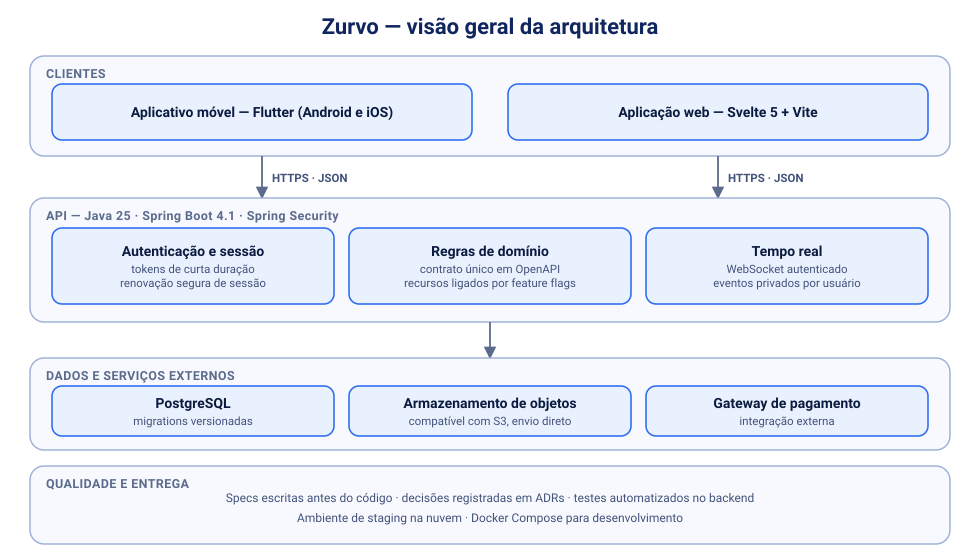
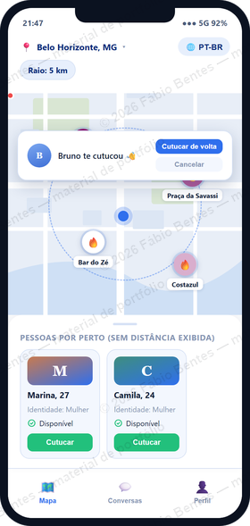
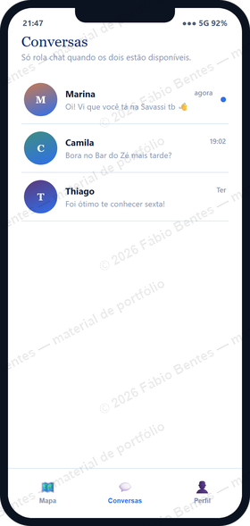

# Zurvo — portfólio técnico

> Material de portfólio de **Fábio A. C. Bentes**. Descreve a **engenharia** do projeto Zurvo, e não o produto.
> O código-fonte e as regras de negócio são privados. Posso apresentar o projeto em uma demonstração ao vivo.

## Sobre

O Zurvo é um aplicativo móvel e web de encontros geolocalizado, construído por mim de ponta a ponta: API, banco de dados, aplicativo Flutter e aplicação web. Em desenvolvimento desde setembro de 2026.

## Competências demonstradas

| Área | O que o projeto exercita |
|---|---|
| **Backend** | Java 25, Spring Boot 4.1 (MVC), Spring Security, JPA, Maven |
| **Segurança** | autenticação com tokens de curta duração e renovação segura de sessão, login social, tratamento cuidadoso de dados pessoais |
| **Dados** | PostgreSQL, migrations versionadas com Flyway |
| **Tempo real** | WebSocket com STOMP, autenticado e com eventos privados por usuário |
| **Mobile** | Flutter (Dart), um único código para Android e iOS |
| **Web** | Svelte 5, Vite |
| **Integrações** | armazenamento de objetos compatível com S3 (envio direto do app), gateway de pagamento, login com Google |
| **Contrato de API** | OpenAPI único, consumido pelo celular e pela web |
| **Qualidade** | desenvolvimento orientado a especificações (mais de 30 specs), ADRs, mais de 260 testes automatizados, *feature flags* |
| **Entrega** | Docker Compose para desenvolvimento, ambiente de staging na nuvem |

## Visão geral da arquitetura

## Decisões de engenharia

- **Contrato primeiro:** o contrato OpenAPI fica no backend e é a fonte comum para o celular e a web, o que evita divergência entre os clientes.
- **Arquivos fora do servidor:** o app envia as imagens direto ao armazenamento, por URL temporária assinada, e o backend só confere e registra. Isso reduz carga, custo e superfície de ataque.
- **Recursos desligados por padrão:** cada integração nova entra atrás de uma *feature flag* com valor seguro, e a configuração incompleta falha na subida com mensagem clara.
- **Escala em estágios:** o plano de crescimento está documentado em ADR, com gatilhos mensuráveis para cada evolução de infraestrutura, em vez de arquitetura sofisticada antes da hora.
- **Decisões registradas:** mudanças relevantes viram ADR, e cada funcionalidade tem especificação, plano e evidências de execução.
- **Manutenção de plataforma:** atualização do runtime para Java 25, verificada pela suíte de testes completa.

## Telas de exemplo

As imagens vêm de protótipo e de dados **fictícios**, em baixa resolução.

| Mapa | Conversas |
|:--:|:--:|
|  |  |

## Estado do projeto

Em desenvolvimento ativo, por verticais. Este material descreve a engenharia, e nem todos os recursos do produto estão concluídos.

---

© 2026 Fábio A. C. Bentes. Todos os direitos reservados. Veja [LICENSE](LICENSE).
